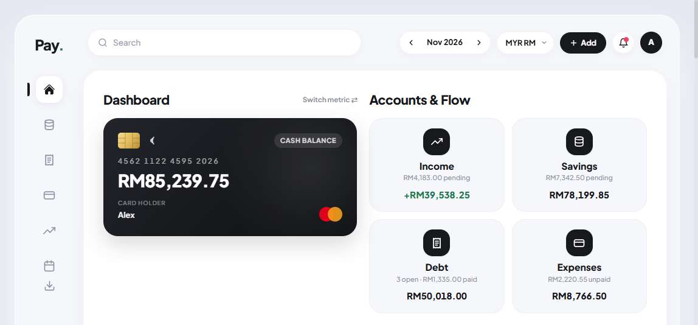
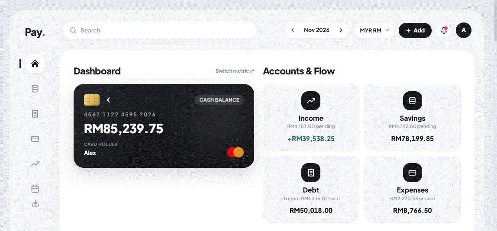

# Pay. — Personal Finance Desktop Tracker

Pay. is my personal desktop project for tracking money in one place. It helps me
understand cash flow, daily earnings, spending, savings, debts, budgets, and
overall net worth without depending on a cloud account.

The app is built as an offline-first Electron application. Data is stored locally
on the computer, while live currency rates are an optional online enhancement
with built-in fallback rates available when there is no connection.

> This is a personal project built for my own financial tracking workflow. It is
> shared publicly as a portfolio and learning project.

## Preview



## Demo

The animated demo below cycles through the dashboard, savings, debt, expenses,
income, and daily earning calendar screens:



## Features

- Dashboard for cash balance, income, savings, debt, and expenses
- Daily earning and income tracking
- Budgets and recurring transactions
- Debt and repayment tracking
- Savings goals and net-worth calculations
- Monthly cash-flow rollover
- Local automatic persistence through browser storage
- JSON export, import, and safety backups
- Offline-friendly interface with optional live currency rates
- Desktop installers for Windows, macOS, and Linux

## Requirements

- Node.js 18 or newer (LTS recommended)
- npm

## Run locally

```bash
npm install
npm start
```

The app opens in a maximized window. Press **F11** on Windows/Linux or
**Ctrl+Cmd+F** on macOS for true full-screen mode. Press **Alt** to show the
application menu.

## Build installers

Build an installer on the operating system you want to package:

```bash
npm run dist:win
npm run dist:mac
npm run dist:linux
```

Installer output is written to the ignored `release/` directory.

## Development

The application page is [`app/index.html`](app/index.html). Styles are generated
from [`src/input.css`](src/input.css) using Tailwind CSS:

```bash
npm run build:css
```

Use the watcher during UI development:

```bash
npm run watch:css
```

## Tests

Run the finance-engine test suite with:

```bash
npm test
```

The tests use Node's built-in test runner and throwaway data. They do not access
or modify saved app entries.

## Data and privacy

Entries are saved locally inside the app's own storage. The app does not require
an account or a hosted database.

Use the download icon in the sidebar to export a JSON backup. The settings menu
also provides **Import JSON Backup** and **Download Safety Backup**. Safety copies
are created automatically before data upgrades, imports, sample-data loading, or
clearing all data.

Do not commit exported backups, `.env` files, credentials, or private keys. The
repository's [`.gitignore`](.gitignore) excludes these local files.

## Project structure

```text
main.js                 Electron main process and application window
package.json            Scripts and Electron Builder configuration
app/index.html          Application screens and UI logic
app/finance-engine.js   Shared money calculations
app/styles.css          Compiled application styles
app/fonts/              Bundled Inter and Plus Jakarta Sans fonts
src/input.css           Tailwind CSS source
tests/                  Finance-engine tests
build/icon.png          Application icon
FIXES.md                Money-logic fixes and historical notes
docs/dashboard.png      README interface screenshot
```

## License

This repository is currently marked as an unlicensed personal project in
[`package.json`](package.json). Contact me before reusing the code or assets in
another project.
